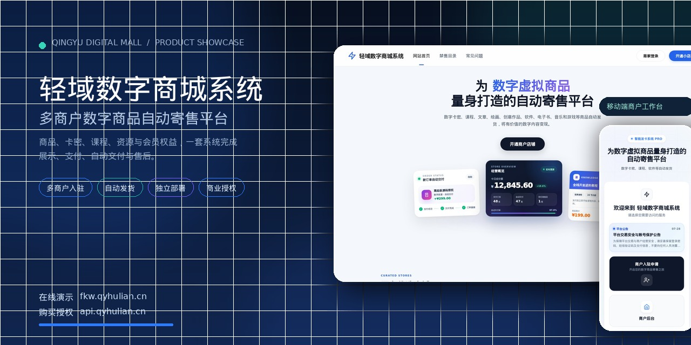
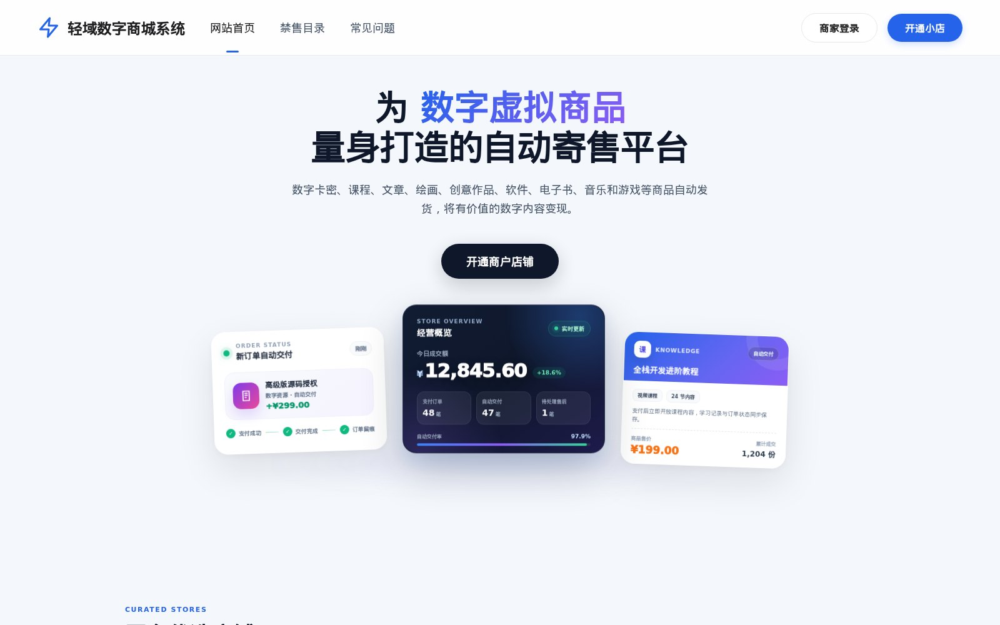
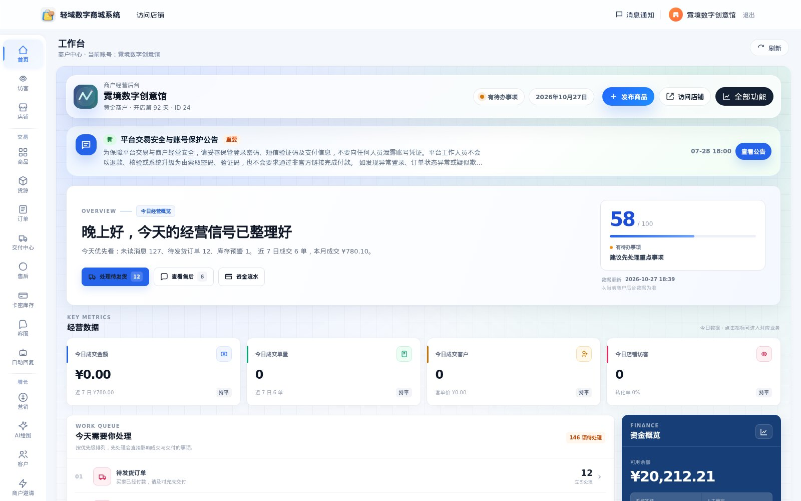
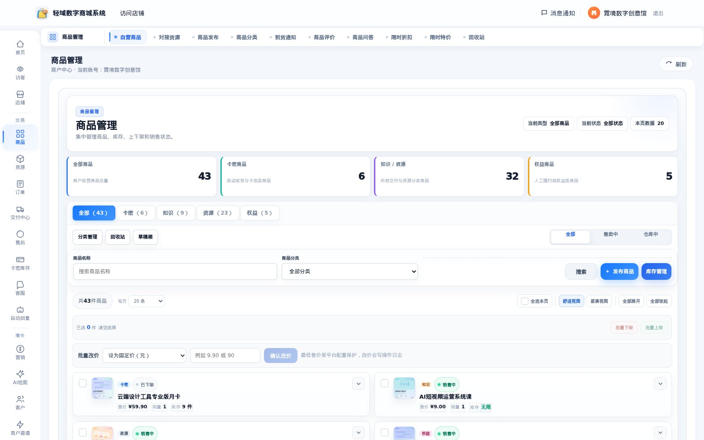
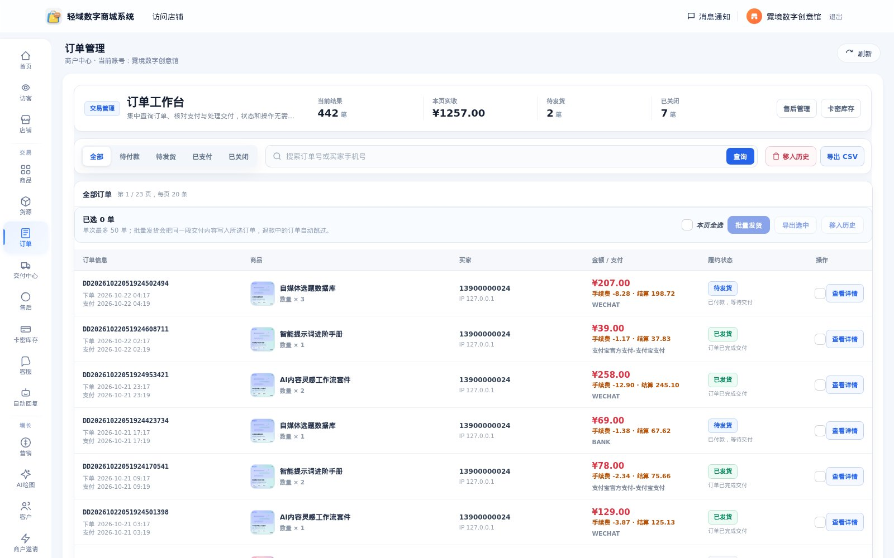
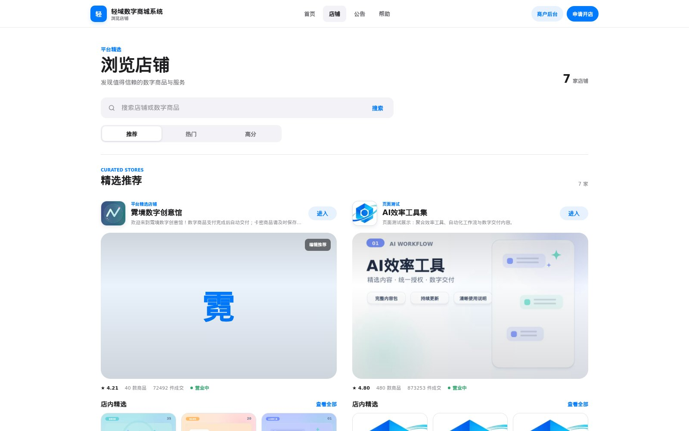
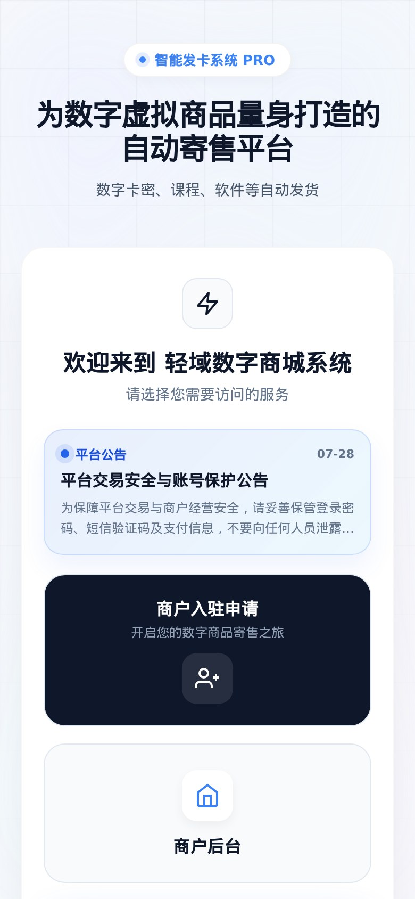
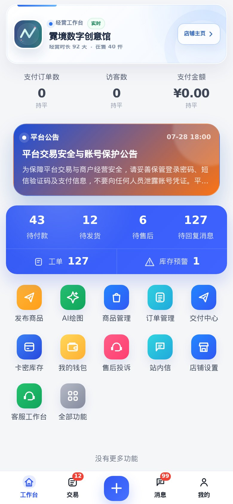

  

<h1 align="center">轻域数字商城系统</h1>

  多商户 · 数字商品 · 自动发货 · 独立部署 · 商业授权

  <a href="https://fkw.qyhulian.cn/"><strong>在线演示</strong></a>
  &nbsp;·&nbsp;
  <a href="https://api.qyhulian.cn/"><strong>购买商业授权</strong></a>
  &nbsp;·&nbsp;
  <a href="https://api.qyhulian.cn/index.php?r=store/contact"><strong>联系咨询</strong></a>

  
  
  
  

> **这是一个产品展示仓库，不是开源项目。**  
> 仓库不包含可运行的商城源码、数据库或安装包。购买商业授权后，通过授权中心获取安装包、授权码和部署支持。

---

## 一套系统，经营数字商品的全链路

轻域数字商城系统面向数字内容与虚拟商品经营者，提供 **平台总后台 + 商户后台 + 买家店铺** 三端能力。

商品可以是卡密、课程、文章、绘画、创意作品、软件、电子书、音乐、游戏、会员权益或数字资源。支付完成后，系统按商品规则自动交付，或进入人工交付流程；订单、售后、库存、资金和客服记录都在同一套系统里闭环。

  

买家端首页 · 数字虚拟商品自动寄售

---

## 界面预览

### 商户工作台

商户可以查看经营概览、待办事项、订单、资金和店铺数据，不需要在多个后台之间切换。

  

### 商品管理

支持卡密、知识/资源、权益等数字商品类型；可管理商品、库存、上架状态、价格和交付方式。

  

### 订单工作台

集中处理待付款、待发货、已支付、售后和关闭订单；支持批量操作、订单查询和交付记录。

  

### 多商户店铺

平台可以展示和运营多个独立店铺，每个商户拥有自己的店铺首页、商品和经营数据。

  

### 移动端

买家端和商户端都适配手机访问，适合微信内分享、移动下单和随时处理订单。

  
  &nbsp;&nbsp;&nbsp;&nbsp;
  

左：买家端首页 &nbsp;·&nbsp; 右：移动端商户工作台（演示数据）

---

## 核心能力

| 模块 | 能力 |
|---|---|
| 多商户平台 | 商户入驻申请、平台审核、独立店铺、店铺装修、商户等级、平台公告 |
| 数字商品 | 卡密、知识/资源、会员权益等商品类型；自动交付、人工交付、库存预警 |
| 订单与交付 | 下单、支付、交付中心、订单查询、批量发货、交付留痕 |
| 售后与客服 | 售后申请、工单、站内消息、客服工作台、自动回复、违规申诉 |
| 营销增长 | 优惠券、限时折扣、会员权益、商户邀请、AI 绘图工具（按版本配置） |
| 资金与对账 | 商户钱包、资金流水、提现申请、对账单、平台结算 |
| 合规与风控 | 禁售目录、实名/人脸核验接口、商户认证、操作日志、安全提醒 |
| 独立部署 | PHP 原生架构，无框架依赖；授权码绑定域名，支持续期、迁移和版本更新 |

> 功能可用范围以实际授权版本和后台配置为准。演示站展示了通用发行版的主要界面。

---

## 适合哪些业务

- **数字内容创作者**：课程、文章、素材、模板、音效、电子书
- **软件与工具服务商**：软件授权、激活码、插件、脚本、SaaS 兑换权益
- **资源与会员站**：资源包、会员权益、社群权益、付费知识库
- **多商户平台运营者**：需要商户入驻、分店管理、平台抽成和统一收银的场景

---

## 授权与交付

本项目采用 **通用安装包 + 授权码** 的交付方式：

1. 在 [轻域互联授权中心](https://api.qyhulian.cn/) 选择授权版本并完成购买。
2. 支付回调验签通过后，在订单页获取安装包下载入口和授权码。
3. 将安装包解压到网站根目录，按包内 `README.md` 完成环境检测、数据库导入和管理员初始化。
4. 安装时填写授权码，授权中心校验产品、构建码、域名、有效期和安装名额。
5. 后续续期、域名变更、服务器迁移和版本更新，通过授权中心统一处理。

> 同一套程序可以绑定多个域名，多个域名访问同一套商城和同一个数据库；具体域名额度和安装实例数以购买的套餐为准。

---

## 技术栈与环境

| 项目 | 要求 |
|---|---|
| 后端 | 原生 PHP，无 ThinkPHP/Laravel，无 Composer 依赖 |
| PHP | 7.4 – 8.5（推荐 8.0 – 8.3） |
| 数据库 | MySQL 5.7.6 – 8.0 |
| Web 服务器 | Nginx 或 Apache（需配置伪静态） |
| 操作系统 | Linux（CentOS / Rocky / Alma / Ubuntu 等） |
| 必选扩展 | curl、openssl、pdo、pdo_mysql、mbstring、json、fileinfo、gd |
| 推荐配置 | 2 vCPU / 2GB 内存起；小型单店最低 1 vCPU / 1GB |

安装包内置环境检测、安装向导、计划任务说明、系统自检和备份说明。详细步骤以授权用户拿到的安装包内文档为准。

---

## 常见问题

**这是开源项目吗？**  
不是。本仓库只用于产品展示、界面预览和授权咨询，不提供源码下载，也不采用 MIT/GPL 等开源许可。

**可以先看演示吗？**  
可以。演示站：[https://fkw.qyhulian.cn/](https://fkw.qyhulian.cn/)。演示数据仅用于展示界面和流程，不代表真实交易。

**购买后能得到什么？**  
商业授权、对应版本的安装包、授权码、安装说明和授权期内的版本更新/迁移支持。具体权益以购买页面和授权协议为准。

**支持多域名吗？**  
支持。多个域名可以指向同一套程序和同一个数据库，授权中心统一管理域名绑定；额度和安装实例数按套餐执行。

**可以二次开发吗？**  
需要根据授权协议和具体需求事先确认。未经书面许可，不得转售、再分发、去除授权机制或用于违法业务。

**订单和资金安全吗？**  
系统包含支付回调验签、订单状态校验、授权码加密保存、后台权限、操作日志和备份机制。生产环境仍需要运营者配置 HTTPS、强密码、计划任务、备份和商户资质。

---

## English

**Qingyu Digital Mall** is a self-hosted, multi-vendor platform for selling digital products such as license keys, courses, downloadable resources and member benefits. It covers storefronts, merchant onboarding, automatic delivery, orders, after-sales, customer service, finance and commercial licensing.

This repository is a product showcase only. The source code and installation package are not public. A commercial license is required for deployment.

- Live demo: [https://fkw.qyhulian.cn/](https://fkw.qyhulian.cn/)
- License & purchase: [https://api.qyhulian.cn/](https://api.qyhulian.cn/)
- Contact: [qyhulian@163.com](mailto:qyhulian@163.com)

---

## 联系与授权

- 官网/授权中心：[https://api.qyhulian.cn/](https://api.qyhulian.cn/)
- 在线演示：[https://fkw.qyhulian.cn/](https://fkw.qyhulian.cn/)
- 联系我们：[https://api.qyhulian.cn/index.php?r=store/contact](https://api.qyhulian.cn/index.php?r=store/contact)
- 邮箱：qyhulian@163.com
- QQ：3690808196

  © 2026 轻域互联 · 轻域数字商城系统 · 商业授权，保留所有权利 
  <a href="https://beian.miit.gov.cn/" target="_blank" rel="noopener">冀ICP备2024068359号</a>

